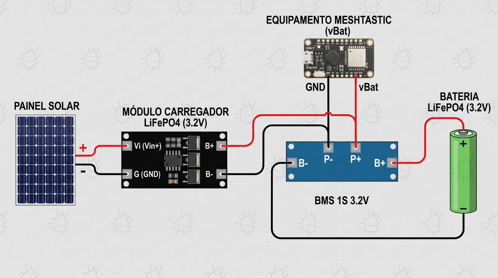

> **Aviso:** esta solução foi testada e está em uso por vários utilizadores, mas é uma adaptação (um *hack*) e não uma configuração suportada oficialmente pelos fabricantes das placas nem pelo firmware Meshtastic. Tem isso em conta antes de a montar: segues este guia por tua conta e risco, e o comportamento pode variar com a placa, os módulos e a versão do firmware.

## Visão geral

Este guia descreve a montagem e a soldadura de um nó Meshtastic alimentado por um painel solar, com uma bateria LiFePO4 de 3,2 V, um módulo carregador dedicado e uma placa de proteção (BMS) 1S.

## Componentes

| Componente | Função no circuito | Especificações |
| --- | --- | --- |
| **Módulo carregador LiFePO4** | Gestão da carga solar | Entrada DC de 3,8 V a 6 V; tensão de carga de 3,6 V (dedicado a LiFePO4 1S). |
| **BMS 1S** | Proteção da célula | Proteção contra sobrecarga (acima de 3,65 V), descarga profunda (abaixo de 2,0 V) e curto-circuito, para célula de 3,2 V. |
| **Equipamento Meshtastic** | MCU e rádio LoRa | Placa do nó com pinos de alimentação `vBat` e `GND`. |
| **Bateria LiFePO4** | Armazenamento de energia | Célula individual de 3,2 V nominais. |
| **Painel solar** | Fonte de energia | Saída ideal de 5 V (máximo de 6 V). |

## Código de cores

- **Fio vermelho:** linha positiva (`+`, `vBat`, `Vin+`).
- **Fio preto:** massa ou negativo (`-`, `GND`).

## Lista de ligações

Usa esta tabela como checklist durante a soldadura.

| Origem | Pad ou terminal | Destino | Pad ou pino | Cor | Função |
| --- | --- | --- | --- | --- | --- |
| **Painel solar** | Positivo (`+`) | **Carregador** | `Vi` (`Vin+`) | Vermelho | Entrada solar positiva (3,8 V a 6 V) |
| **Painel solar** | Negativo (`-`) | **Carregador** | `G` (`GND`) | Preto | Massa do painel solar |
| **Carregador** | `B+` | **BMS 1S** | `P+` | Vermelho | Saída de carga positiva (3,6 V) |
| **Carregador** | `B-` | **BMS 1S** | `P-` | Preto | Saída de carga negativa |
| **BMS 1S** | `P+` | **Meshtastic** | `vBat` | Vermelho | Alimentação positiva do nó |
| **BMS 1S** | `P-` | **Meshtastic** | `GND` | Preto | Massa do nó através da BMS |
| **BMS 1S** | `B+` (extremidade) | **Bateria LiFePO4** | Polo positivo (`+`) | Vermelho | Ligação ao polo positivo |
| **BMS 1S** | `B-` (extremidade) | **Bateria LiFePO4** | Polo negativo (`-`) | Preto | Ligação ao polo negativo |

## Soldadura passo a passo

### 1. Ligar o carregador à BMS

1. Solda um fio vermelho do pad `B+` do carregador ao pad `P+` da BMS.
2. Solda um fio preto do pad `B-` do carregador ao pad `P-` da BMS.

### 2. Ligar a BMS ao equipamento Meshtastic

1. Solda um fio vermelho do pad `P+` da BMS ao pino `vBat` do Meshtastic.
2. Solda um fio preto do pad `P-` da BMS ao pino `GND` do Meshtastic.

### 3. Ligar a bateria LiFePO4

> **Atenção:** mantém a ponta do ferro de soldar no máximo 2 a 3 segundos sobre os terminais da bateria, para evitar danos térmicos.

1. Solda um fio vermelho do pad `B+` (extremidade da BMS) ao polo positivo (`+`) da bateria.
2. Solda um fio preto do pad `B-` (extremidade da BMS) ao polo negativo (`-`) da bateria.

### 4. Ligar o painel solar

1. Solda o fio vermelho do polo positivo (`+`) do painel ao pad `Vi` (`Vin+`) do carregador.
2. Solda o fio preto do polo negativo (`-`) do painel ao pad `G` (`GND`) do carregador.

## Verificações de segurança

1. **Tensão do painel:** garante que a tensão do painel em aberto nunca ultrapassa 6 V. Os painéis comuns de 5 V são os adequados.
2. **Teste de continuidade:** antes de ligar a bateria, confirma com um multímetro que não há curto-circuito entre `P+` e `P-`.
3. **Isolamento:** aplica manga termorretrátil ou fita isoladora (ou Kapton) em todos os pontos de soldadura expostos.

## LiFePO4 e o firmware Meshtastic

A maioria das placas para Meshtastic (RAK, Heltec, placas ESP32, entre outras) foi desenhada e calibrada para baterias de iões de lítio ou LiPo (3,7 V nominais, 4,2 V em carga completa).

A bateria LiFePO4 trabalha numa gama de tensão inferior (3,2 V nominais, 3,65 V em carga completa) e tem uma curva de descarga muito plana. Por isso, o nó vai muito provavelmente indicar uma percentagem de bateria baixa e disparar alarmes de bateria fraca antes do tempo.

### Soluções recomendadas

1. **Usar uma bateria de maior capacidade:** células como 26650 ou 32700, de 4000 mAh a 6000 mAh, garantem maior autonomia e estabilidade, mesmo que a tensão lida pareça baixa.
2. **Ajustar a configuração de energia:** nas definições do nó (aplicação Meshtastic ou CLI), em **Power Configuration**, o multiplicador do ADC (*ADC Multiplier Override*) permite calibrar a leitura de tensão. Em alternativa, ignora ou desativa as notificações de bateria fraca. Para mais informação, consulta a [documentação de Power Configuration do Meshtastic](https://meshtastic.org/docs/configuration/radio/power/).
