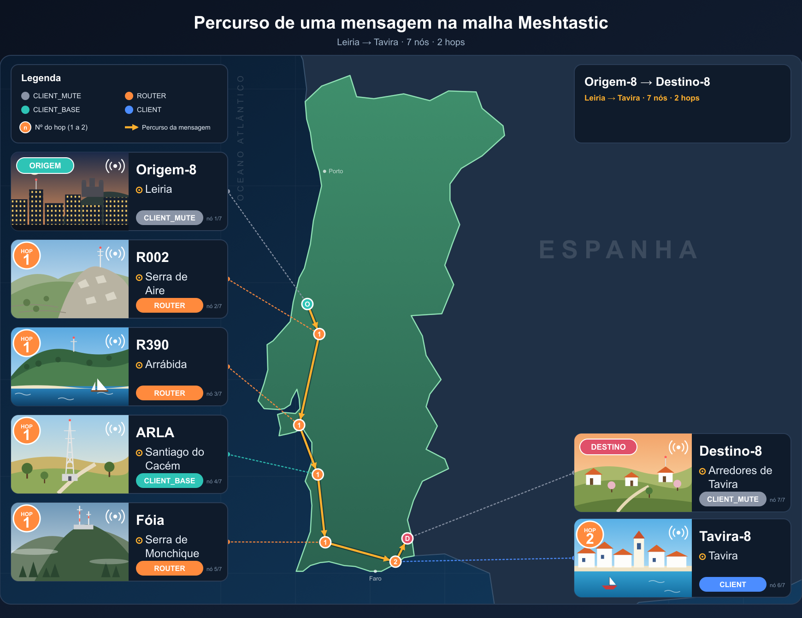

## Ligar Portugal de lés a lés
Deixou de ser verdade que o Meshtastic só permite 7 saltos. Para tal é necessário que a comunidade se una na definição correcta das configurações, e marcação de favoritos nos rádios dedicados à retransmissão de mensagens (Client Base, Router e Router Late). Se tem um desses rádios, reveja os vizinhos que sejam de um desses tipos, e marque-os como favoritos na aplicação ou remotamente. Peça-lhes para fazer o mesmo. Vamos encurtar hops e alongar caminhos!

**Nota:** Num [blog oficial](https://meshtastic.org/blog/zero-cost-hops-favorite-routers/) refere-se que o Zero Cost Hop só se verifica entre nós Router e Router Late, mas essa informação está desactualizada. Como se pode consultar no [código](https://github.com/meshtastic/firmware/blob/d0f4096788545fb3c5e22d2a7e52ac6c268caac1/src/mesh/Router.cpp#L255), as condições para não descontar hop são:
1. Não ser o primeiro salto
2. O nó que está a retransmitir o pacote ser CLIENT_BASE, ROUTER ou ROUTER_LATE
3. O nó que fez o salto anterior (relay_node) ser CLIENT_BASE, ROUTER ou ROUTER_LATE
4. O nó que fez o salto anterior (relay_node) estar marcado como favorito no nó que está a retransmitir

## Introdução: Hops
Numa rede mesh, as mensagens vão passando de rádio em rádio. Cada rádio configurado para repetir mensagens emite as mensagens que recebe seguindo certas regras. No caso do Meshtastic a maioria dos rádios podem servir como  retransmissores. 
 

Cada vez que um rádio retransmite uma mensagem esse salto designa-se por "hop". O número máximo de "hops" que uma mensagem pode consumir é definido ao início, por configuração do rádio de origem e é descontado em cada salto. O número de "hops" consensualizado em Portugal é de 4 hops em geral e 5 em rádios com o perfil de Client Mute (Cliente Silenciado) que tenha um Client Base a servi-lo. Tecnicamente o Meshtastic pode configurar-se com o máximo de 7 hops.

A limitação técnica dos 7 hops deriva da estrutura de pacote que foi definida ao início e não poderá ser aumentada sem causar incompatibilidade entre versões. Para os "techies", o header do pacote tem 3 bits alocados para o número de hops, pelo que só aceita até 7.

## O problema
A discussão em torno dos hops no Meshtastic envolve na realidade vários aspectos ou preocupações:

- O número baixo de hops tenta evitar que um pacote ande "às voltas" em redes densas. A repetição de pacotes pode "entupir" a frequência rádio (limitada pelo tempo de transmissão e pelo "duty cycle")
- Em algumas meshes ficaram célebres problemas devido ao excesso de rádios a trabalharem como "router" que tendem a repetir muito rapidamente os pacotes, sem preocupação de "ouvir" se o pacote já foi retransmitido na zona. Esta má configuração da rede, aliada a um número alto de hops pode esgotar os parcos recursos da rede LoRa
- O baixo número de hops recomendado para evitar os problemas anteriores pode restringir muito a rede, ou o caminho que uma mensagem pode percorrer, especialmente em malhas ou zonas mais densamente povoadas de rádios
- Mesmo que a rede esteja bem distribuída (entre os vários roles), e que potencialmente pudesse funcionar bem com mais hops, a forma de representação do número de hops, adoptada ao início, impede o seu aumento sem causar incompatibilidade de versões

## A solução
Face aos vários problemas enunciados anteriormente, o desenvolvimento do Meshtastic criou uma solução que permitirá caminhos mais longos, sem potenciar os riscos, e sem criar incompatibilidades. Como se explicou acima, o número de hops impede potenciais caminhos mais longos pois cada hop desconta "1" ao número de hops disponíveis... Mas... e se certos saltos não descontarem um hop? Foi precisamente isso que foi pensado e implementado: A possibilidade de certos saltos não descontarem um hop.  

Esta opção não pode ser feita sem critério, pois facilmente poderia levar ao eternizar da circulação de mensagens, entrando rapidamente nos problemas enunciados anteriormente. 

Assim,  esta solução, que se designou por "zero cost hops", só se aplica entre saltos de nodes "estruturais". Para este efeito consideram-se "estruturantes" os rádios que estejam configurados como CLIENT BASE, ROUTER (Roteador) ou ROUTER LATE. O Zero Cost Hop requer também que o rádio anterior esteja definido como favorito no rádio que vai retransmitir. Mais ainda, há certos saltos que são sempre descontados (aqui entramos em detalhes desnecessários, mas podemos dizer que o primeiro salto será sempre descontado por exemplo). Vejamos isto com um exemplo mais "visual":

Um rádio "Origem-8" em Leiria quer enviar uma mensagem para o Algarve, para o rádio "Destino-8".


Este caminho plausível necessitaria de 5 hops. Mas vamos assumir que no R390 se adicionou o R002 como favorito, no ARLA se adicionou o R390 como favorito e no Foia se adicionou o ARLA como favorito. Então ficaria:




Ou seja, a mensagem passaria na mesma por 5 saltos, mas apenas 2 seriam contados.
Desta forma, com as configurações bem definidas, podemos privilegiar caminhos "lógicos" e curtos, e assim chegar (muito) mais longe, sem aumentar os hops configurados.

A título meramente ilustrativo... De Vila de Rei em Portugal a Pequim na China serão aproximadamente 9530Km.
De Algés à Arrábida são aproximadamente 30km e consegue-se chegar sem saltos. Imaginemos assim que conseguimos distribuir nós entre Vila de Rei e Pequim com uma distância média de 30km entre eles. Um pacote no modo LongFast pode demorar em média cerca de 0.7 segundos a transmitir e cada nó terá um atraso para o retransmitir. Para simplificar as contas consideremos que cada salto demoraria 1s. E que todos estes nós estavam como favoritos nos seguintes e vice versa... Assim teríamos 9530km/30, o que daria 317 hops, portanto segundo a simplificação 317s o que ronda os 5 minutos. Isto para ir...

Naturalmente, com tantos saltos e tanto tempo, isto é algo que na prática seria inviável, mas que a configuração permitiria.


Agora, se lhe perguntarem se o Meshtastic pode chegar à China, pode responder que sim! E que poderia demorar uns 5 minutos a ir e outros tantos a receber a resposta!

## Como fazer
Como muitas soluções, esta só funciona se for bem implementada. Para tal há que seguir os seguintes passos:


1. Só aplicar estas regras se tivermos um rádio de um dos três papéis referidos: CLIENT BASE, ROUTER ou ROUTER LATE. 
2. Ser criterioso na definição do tipo de dispositivo. Não usar ROUTER ou ROUTER LATE de forma descoordenada da rede em redor ou em zonas de fraco alcance.
3. Detectar os "vizinhos", ou seja, os rádios que nos cheguem sem saltos intermédios (terão SNR detectado), e devemos confirmar isso com um traço de rota que deve mostrar ligação directa sem nós intermédios.
4. Dos vizinhos identificados no ponto anterior escolher os que sejam de um dos três tipos referidos: CLIENT BASE, ROUTER ou ROUTER_LATE, e que proporcionem "bons" caminhos de rede, e marcá-los como favoritos
5. Tentar interagir com a comunidade para que os donos dos rádios que marcámos como favoritos façam o reverso, ou seja, marquem o nosso como favorito. Só assim o caminho ficará "mais curto" em ambos os sentidos


## Questões:
-  Q1: Tenho um rádio em modo CLIENT, mas muito bem colocado e com ligação directa a vários rádios dos três tipos referidos. Devo colocá-los como favoritos? 

Não! Este mecanismo do zero cost hop não funciona em rádios que não sejam CLIENT BASE, ROUTER ou ROUTER LATE, ou quando o rádio a "favoritar" não seja desse tipo. Pode haver outros motivos para os marcar como favoritos (não serem removidos nas limpezas da base de dados de rádios por exemplo), mas para este efeito é inútil.

O que poderia fazer sentido neste caso era mudar o tipo de dispositivo para CLIENT BASE, se isso permitir estender a rede.

- Q2: Tenho um rádio de um dos tipos referidos e coloquei um vizinho que é de um desses tipos como favorito. Mas não o  consegui contactar para que ele fizesse o reverso. Devo manter ou eliminá-lo de favorito?

Deve manter. Isso só beneficia o caminho num sentido, que não sendo o ideal pode sempre ajudar pois o caminho inverso pode beneficiar da redução de hops  noutros pontos. Devemos fazer o que pudermos, pedir à comunidade que faça o que puder, e esperar que isso se concretize em algum momento.

- Q3: Tenho um rádio configurado com um dos tipos referidos, mas está longe e bastante inacessível. Como tal é-me impossível fazer isto sem conseguir ligar a aplicação ao rádio, correcto?

Incorrecto. Qualquer rádio montado em pontos de visita mais difícil devem estar configurados para administração remota (a cobrir noutra parte da wiki). Estando configurado para administração remota, é possível com o cliente Python do Meshtastic dar ordem para um rádio remoto guardar como favorito um outro rádio. Consideremos que temos um rádio acessível por TCP/IP com o endereço 192.168.1.20 e a chave pública deste rádio foi configurado na zona de administração remota de um rádio com o ID "b0a1de1a" que tem como vizinho o rádio com o ID "DeadBeef" que queremos marcar como favorito então podemos dar o comando:

```
meshtastic --host 192.168.1.20 --dest "!b0a1de1a" --add-favorite "!DeadBeef"
```

Se tivermos o rádio emparelhado por Bluetooth podemos usar o nome do dispositivo e o comando seria:

```
meshtastic --ble DOOM_babe --dest "!b0a1de1a" --add-favorite "!DeadBeef"
```

E para um rádio ligado por USB:

```
meshtastic --port COM5 --dest "!b0a1de1a" --add-favorite "!DeadBeef"
```
**Nota:** Os nomes, endereços e porta série apresentados são meramente exemplificativos e têm de ser ajustados aos seus casos.


-  Q4: Tenho um CLIENT BASE. Ao definir vizinhos dos tipos CLIENT BASE, ROUTER e ROUTER LATE como favoritos, não estou a alterar-lhe o comportamento (passar a actuar como ROUTER LATE) para mensagens recebidas desses vizinhos?

Sim, e não. Essa mudança de comportamento, que é a essência de um CLIENT BASE, só ocorre para os pacotes cuja origem sejam esses vizinhos. Os pacotes retransmitidos por esses vizinhos, que tenham origem noutros rádios, não ficam sujeitos a esse comportamento. E os rádios dos tipos CLIENT BASE, ROUTER ou ROUTER LATE, se bem configurados serão a origem de muito poucos pacotes, pois não são normalmente usados por pessoas ou aplicações.