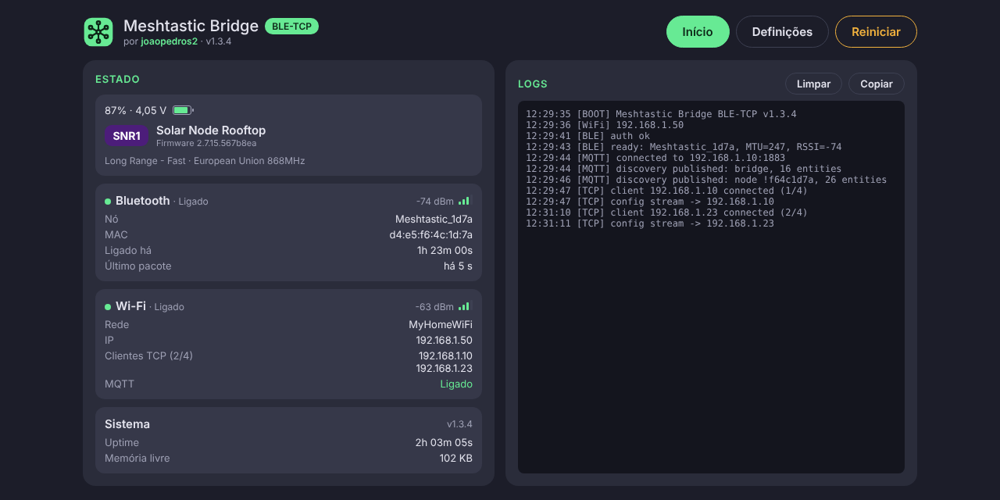

## O que é

O **Meshtastic Bridge BLE-TCP**, criado por [`joaopedros2`](https://github.com/joaopedros2), é um firmware para ESP32 que faz de ponte entre um nó Meshtastic e a rede de casa. O ESP32 fica junto do nó, liga-se a ele por Bluetooth LE e disponibiliza a API TCP padrão do Meshtastic na porta 4403.

Foi pensado para nós nRF52 sem Wi-Fi, como o SenseCAP Solar Node, RAK4631, T-Echo ou T1000-E. Com a ponte, as apps Meshtastic, a CLI Python e o Home Assistant ligam-se ao nó pelo IP, em casa ou à distância por VPN, sem ser preciso um computador sempre ligado.

É um projeto independente. A documentação, o código e o acompanhamento de problemas são mantidos pelo autor.

## O que permite fazer

- **Ligar por rede a um nó só com Bluetooth:** a app Meshtastic (Android, iOS, Windows) usa a ligação do tipo *Rede* com o IP da ponte.
- **Vários clientes ao mesmo tempo:** até 4, por exemplo o Home Assistant e a app. O tráfego da mesh chega a todos.
- **Configurar tudo pela página web:** rede Wi-Fi, procura e escolha do nó Bluetooth, PIN, nome na rede e password da página, em português ou inglês.
- **Integrar no Home Assistant por MQTT:** a ponte e o nó aparecem como dois dispositivos, com bateria, tensão, utilização do canal, nós online, contadores de pacotes, noise floor, posição e diagnósticos.
- **Atualizar o firmware pelo browser** (OTA), sem cabo.

## Hardware

Qualquer ESP32 com Wi-Fi, Bluetooth LE e pelo menos 4 MB de flash: ESP32, ESP32-S3, ESP32-C3 ou ESP32-C6. O ESP32-S2 (sem Bluetooth) e o ESP32-H2 (sem Wi-Fi) não servem.

O alcance do Bluetooth é o principal limite. Coloca o ESP32 perto do nó e procura um RSSI Bluetooth melhor que cerca de −85 dBm. Uma placa com antena externa ajuda.

## Instalar

1. Descarrega o `.bin` da versão mais recente nos [releases do projeto](https://github.com/joaopedros2/meshtastic-bridge-ble-tcp/releases), ou compila o código com o [PlatformIO](https://platformio.org/).
2. Grava o firmware no ESP32 pela USB. As atualizações seguintes podem ser feitas na própria página da ponte, em **Definições → Firmware**.

O [README do projeto](https://github.com/joaopedros2/meshtastic-bridge-ble-tcp/blob/main/README.pt-PT.md) explica a compilação e a gravação em detalhe.

## Primeira configuração

1. Liga o ESP32. Ele cria a rede Wi-Fi `meshtastic-bridge-ble-tcp-XXXX` (password `meshtastic`).
2. Liga-te a essa rede. A página de configuração abre sozinha; se não abrir, vai a `http://192.168.4.1`.
3. Em **Definições → Wi-Fi**, escolhe a tua rede e guarda. A ponte reinicia e liga-se a ela.
4. Em **Definições → Nó Bluetooth**, procura o nó, escolhe-o, escreve o PIN e guarda.
5. Confirma que nenhum telemóvel ou computador está ligado ao nó por Bluetooth: o nó só aceita uma ligação Bluetooth de cada vez.

Nos nós com ecrã, o PIN é aleatório. Antes de configurares a ponte, muda o modo de emparelhamento para **Fixed PIN** na app Meshtastic (o PIN predefinido é `123456`).

## Ligar à ponte

- **App Meshtastic:** escolhe a ligação do tipo *Rede* e indica o IP da ponte.
- **Home Assistant:** usa a [integração Meshtastic](https://github.com/meshtastic/home-assistant) com ligação TCP ao IP da ponte, porta 4403, ou ativa o MQTT em **Definições → MQTT** para os dispositivos aparecerem por discovery.
- **CLI Python:** `meshtastic --host <ip-da-ponte> --info`

## Antes de utilizar

- A ponte ocupa a ligação Bluetooth do nó. Para usares o telemóvel diretamente por Bluetooth, desliga a ligação ao nó em **Definições → Nó Bluetooth** ou liga-te pela ponte.
- Usa uma ponte por nó. Cada ponte tem um nome próprio na rede e no Home Assistant, a partir do identificador do chip.
- Os valores do nó (bateria, estatísticas) chegam com a telemetria que o nó envia aos clientes, por isso atualizam enquanto houver um cliente ligado.

## Segurança

- A porta 4403 não tem autenticação, tal como a API TCP do próprio Meshtastic. Mantém a ponte numa rede de confiança ou atrás de uma VPN e não a exponhas diretamente à Internet.
- Define uma password para a página da ponte em **Definições → Segurança**.
- O MQTT não é cifrado e foi pensado para um broker na rede local.

## Ligações

- [Meshtastic Bridge BLE-TCP — código-fonte no GitHub](https://github.com/joaopedros2/meshtastic-bridge-ble-tcp)
- [Releases e firmware](https://github.com/joaopedros2/meshtastic-bridge-ble-tcp/releases)
